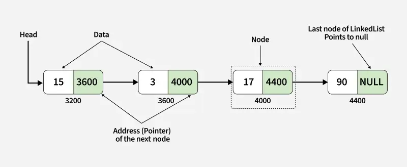

# Explain the Single Link- List concept

A linked list is a fundamental data structure in computer science. It mainly allows efficient insertion and deletion operations compared to arrays. Like arrays, it is also used to implement other data structures like stack, queue and deque.



## Apply Part of Link_list ->
1. INSERTION AT THE END
2. INSERTION IN THE BEGGINING
3. INERTION IN THE MIDDLE 
4. DELETION OF SIGLE LINK-LIST
5. PRINT ALL SINGLE-LINK LIST 

### Explanation

A. INSERTION AT THE END - 

   - built a temporary node temp = Node(value )
   - first check it if(self.head != None)
   - Then make a varible t1 and store self.head
   - while (t1.next != None) so t1 = t1.next
   -  and last insert t1.next = temp
   - other wise self.head = temp 

   ```python 
    def insertAtEnd(self,value):
        temp = Node(value)
        if(self.head != None):
            t1 = self.head
            while (t1.next != None):
                t1 = t1.next
            t1.next = temp
        else:
            self.head = temp
   ```

B. INSERTION IN THE BEGGINING -

- make a node 
- and then  temp.next = self.head
- self.head = temp 

    ```python 
        def insertAtBegging(self,value):
         temp = Node(value)
         temp.next = self.head
         self.head = temp
    ```

C. INERTION IN THE MIDDLE -

- make a node  temp = Node(value)
- store the previous node position on any temp variable (t1 = self.head)
- while (t1.next != None ): 
- if (t1.data == x )
- then update the making node linking address next link list  temp.next = t1.next
- and also next link-list store temp file data t1.next = temp 
- other wise t1 = t1.next 

    ```python
        def insertInMid(self , value , x):
        temp = Node(value)
        t1 = self.head

        while(t1.next != None):
            if(t1.data == x):
                temp.next = t1.next
                t1.next = temp 
            t1 = t1.next
    ```

D. DELETION OF SIGLE LINK-LIST -

- first store self.head at a pointer t1 = self.head
- make a variable for store pointer prev = t1
- if (t1.data == value )
- self.head main t1.next ajayega self.head = t1.next
- the run a while loop t1.next != None 
- if (t1.data == value )
- to prev.next = t1.next and break the loop
- other wise prev = t1
- and t1 = t1.next 
- if (t1.data == value )
- so prev.next = None 

```python 
    def deleteLL(self,value):
        t1 = self.head
        prev = t1 
        if(t1.data == value):
            self.head = t1.next
        while (t1.next != None):
            if (t1.data == value):
                 prev.next = t1.next
                 break 
            else:
                prev = t1
                t1 = t1.next
        if(t1.data == value):
            prev.next = None
```

E. PRINT ALL SINGLE-LINK LIST -
